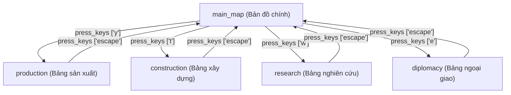

# Hướng Dẫn Chi Tiết Game Skill Pack: Hearts of Iron IV (HOI4) - V1.5

Trong kiến trúc Universal Game MCP V1.5, **Hearts of Iron IV** được triển khai dưới dạng **Game Skill Pack** độc lập tại thư mục `game_skills/hoi4/`, kết hợp cùng bộ máy nhận diện trạng thái UI, đồ thị điều hướng và bộ máy tự học.

---

## 🗺️ Bản Đồ Vùng Giao Diện (Normalized UI Regions)

Tất cả các vùng tọa độ được chuẩn hóa tỉ lệ `[0.0, 1.0]` tương thích với mọi độ phân giải tỷ lệ 16:9 (1080p, 1440p, 4K):

| Tên vùng | Tọa độ chuẩn hóa `[x, y, w, h]` | Ý nghĩa trong game HOI4 |
|---|---|---|
| `topbar` | `[0.0, 0.0, 1.0, 0.05]` | Toàn bộ thanh tài nguyên và chỉ số quốc gia phía trên |
| `political_power` | `[0.040, 0.0, 0.055, 0.04]` | Chỉ số Điểm Chính Trị (Political Power) |
| `stability` | `[0.095, 0.0, 0.055, 0.04]` | Chỉ số Độ Ổn Định Quốc Gia (Stability) |
| `war_support` | `[0.150, 0.0, 0.055, 0.04]` | Chỉ số Ủng Hộ Chiến Tranh (War Support) |
| `manpower` | `[0.205, 0.0, 0.070, 0.04]` | Nhân Lực Quân Sự Hiện Có (Manpower) |
| `factories` | `[0.275, 0.0, 0.065, 0.04]` | Số lượng nhà máy dân sự & quân sự (Factories) |
| `convoys` | `[0.340, 0.0, 0.060, 0.04]` | Đoàn tàu vận tải biển (Convoys) |
| `command_power` | `[0.400, 0.0, 0.060, 0.04]` | Điểm Mệnh Lệnh Quân Sự (Command Power) |
| `date_clock` | `[0.830, 0.0, 0.100, 0.045]` | Ngày tháng và đồng hồ thời gian |
| `speed_controls` | `[0.930, 0.0, 0.070, 0.045]` | Nút tăng giảm tốc độ thời gian (1x - 5x) |
| `pause_indicator`| `[0.850, 0.045, 0.080, 0.035]` | Biển báo trạng thái tạm dừng (PAUSED) màu đỏ |
| `drawer_panel` | `[0.0, 0.05, 0.35, 0.95]` | Ngăn kéo các bảng (Sản xuất, Nghiên cứu, Ngoại giao) |

---

## 🎯 Trạng Thái Giao Diện (UI States) Trong HOI4

Bộ nhận diện `UIStateRecognizer` tự động phân loại giao diện HOI4 thành các trạng thái:
1. `main_map`: Bản đồ chính (thanh topbar hiển thị đầy đủ, không có ngăn kéo mở).
2. `production`: Bảng quản lý dây chuyền sản xuất quân sự và xưởng đóng tàu (phím tắt `y`).
3. `construction`: Bảng xây dựng công trình, hạ tầng, nhà máy (phím tắt `t`).
4. `research`: Bảng cây công nghệ và nghiên cứu khoa học (phím tắt `w`).
5. `diplomacy`: Bảng danh sách quốc gia và ngoại giao (phím tắt `e`).
6. `recruitment`: Bảng huấn luyện và biên chế sư đoàn (phím tắt `u`).
7. `army_selected`: Khi một tập đoàn quân / tướng lĩnh được chọn (thanh chân dung tướng ở đáy màn hình).
8. `unknown`: Giao diện chưa nhận dạng được hoặc màn hình tải / menu chính.

Mỗi kết quả đều có độ tin cậy `confidence`, băm tri giác `phash`, bằng chứng quan sát `evidence` và trạng thái `known` / `ambiguous` / `unknown`.

---

## 🧭 Đồ Thị Dẫn Đường (Navigation Graph) HOI4

Đồ thị dẫn đường cho phép AI di chuyển giữa các trạng thái giao diện mà không cần click mò:

AI gọi `navigate_to(target_state="production", game_id="hoi4")` để tự động thực thi chuyển đổi an toàn và xác minh kết quả sau thao tác.

---

## 🎮 Các Kỹ Năng Tuyển Chọn (Curated Game Skills)

Thư mục `game_skills/hoi4/skills/` cung cấp các kỹ năng tuyển chọn có sẵn:
1. `pause_unpause`: Gửi phím cách (`space`) để tạm dừng / tiếp tục mô phỏng; xác minh sự xuất hiện/biến mất của biển báo `PAUSED`.
2. `open_production`: Nhấn phím `y` để mở bảng sản xuất; xác minh bằng OCR từ khóa `"Production"`.
3. `increase_speed`: Nhấn phím `num+` để tăng tốc độ game; xác minh thay đổi chỉ số tốc độ.
4. `select_army_group`: Định vị chân dung chỉ huy tập đoàn quân và click chọn; xác minh vùng thanh quân sự phía dưới.

> [!IMPORTANT]
> Các kỹ năng tuyển chọn này được bảo vệ nguyên vẹn (Curated Protection). Khi AI phát hiện thao tác mới, hệ thống sẽ lưu vào bộ nhớ bền vững dưới dạng kỹ năng ứng viên (`candidate`), không bao giờ ghi đè trực tiếp lên các tệp trong `game_skills/`.

---

## 💻 Trích Xuất Tài Nguyên Game (Game Asset Indexer)

UGM V1.5 tích hợp công cụ `index_game_assets` giúp đọc trực tiếp các tệp `.gui`, `.gfx`, `.yml` từ thư mục cài đặt Hearts of Iron IV của người dùng:
- Trích xuất tên các sprite giao diện (`spriteType`).
- Trích xuất cấu trúc cửa sổ giao diện (`windowType`).
- Trích xuất từ khóa bản địa hóa (localization keys).
- **Hoàn toàn an toàn**: Chỉ đọc (read-only), không sửa file, không can thiệp bộ nhớ tiến trình game.
